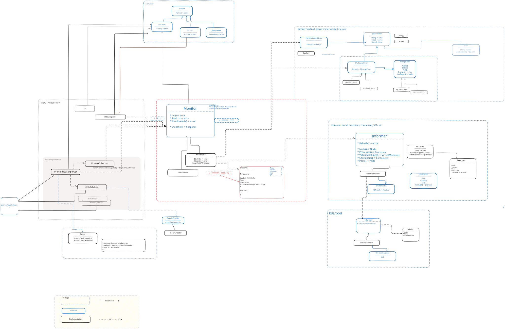
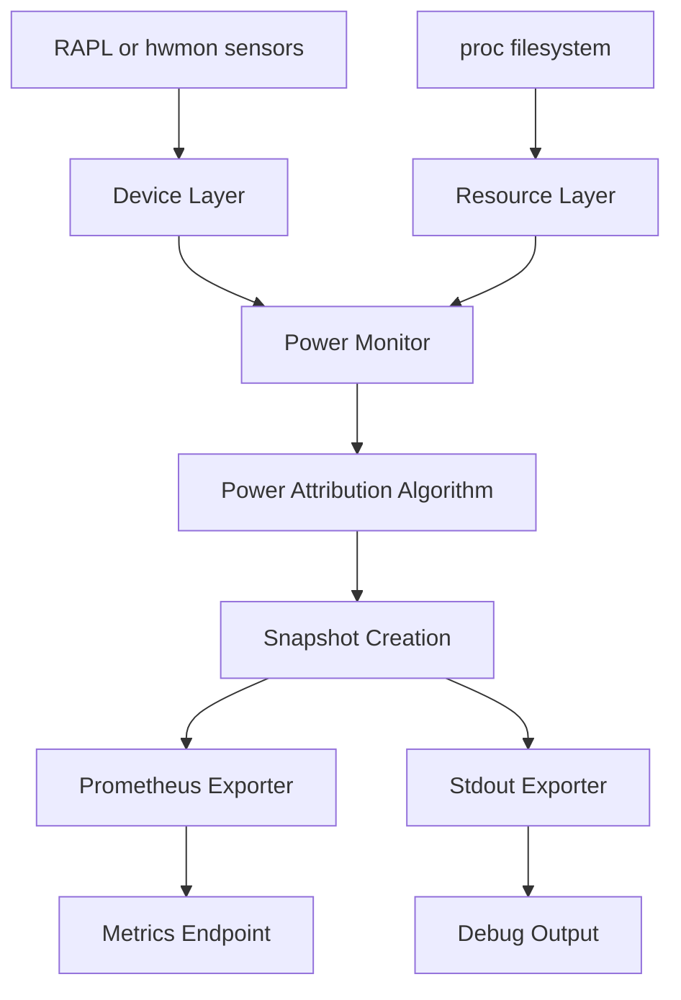

# Data Flow & Power Attribution

This document explains how Kepler transforms raw hardware energy readings into accurate, fair power attribution across different workload levels.

## Overview

The CPU attribution path uses a hardware reading and the CPU time observed during the sampling interval.

```text
Phase 1: Hardware Collection → Phase 2: Node Breakdown → Phase 3: Workload Attribution → Phase 4: Other Workload Levels
```

## System Data Flow



**Data Flow Sequence:**



## Phase 1: Hardware Energy Collection

### Hardware readings

The CPU meter exposes a set of energy zones. For a cumulative energy counter,
the monitor calculates average power as the change in energy divided by elapsed
time. For a power sensor, it integrates the reading over the interval to obtain
energy. [CPU meter selection](../../../../internal/device/cpu_power_meter.go) ·
[Node calculations](../../../../internal/monitor/node.go)

### Counter Wraparound Handling

RAPL counters wrap at their maximum value. The monitor calculates the delta
between consecutive readings as follows.

```text
current >= previous:          current − previous
current < previous, max > 0:  (max − previous) + current
current < previous, max = 0:  0
```

### Energy Zone Types

These RAPL domains can overlap. The primary zone, plus any GPU energy, ranks
terminated workloads. Readings for the other selected zones are still available.

| Zone        | Description            | Coverage                 | Priority |
|-------------|------------------------|--------------------------|----------|
| **psys**    | Platform system energy | CPU + Memory + I/O       | Highest  |
| **package** | CPU package energy     | Cores + Uncore + Cache   | High     |
| **core**    | CPU cores only         | Processing units         | Medium   |
| **dram**    | Memory energy          | System memory            | Medium   |
| **uncore**  | Uncore energy          | Cache, memory controller | Low      |

## Phase 2: Node Energy Breakdown

### Active vs Idle Split

For each zone and interval, the monitor multiplies the energy delta by the
node CPU utilization from `/proc/stat`. The result is active energy in whole
microjoules. The remainder is idle energy. It applies the same utilization
ratio to the zone's power. [Node calculations](../../../../internal/monitor/node.go)

### Mathematical Relationship

```text
Active zone power = zone power × node CPU utilization
Idle zone power = zone power − active zone power
```

## Phase 3: Workload Attribution

### CPU Time-Based Attribution

For each zone, a running process receives a share of active CPU power and
energy proportional to its CPU time. The denominator is the sum of CPU time
deltas across the running processes observed by the resource informer. When
the denominator is zero, the monitor preserves the process's previous energy
total for that lifetime. [Resource informer](../../../../internal/resource/informer.go) ·
[Process attribution](../../../../internal/monitor/process.go)

### Attribution Formula

```text
CPU time share = process CPU time delta / sum of observed process CPU time deltas
Process power = CPU time share × active zone power
Process energy increment = whole microjoules in (CPU time share × active zone energy increment)
```

For example, if a zone supplies 50 W of active power and a process accounts
for one fifth of observed CPU time, the process is attributed 10 W. Each
process's energy increment is truncated to whole microjoules, so the sum of
the increments can be slightly below the zone's active energy.

## Phase 4: Other Workload Levels

Processes, containers, VMs, and pods each take CPU power from the same node active
power. A container does not sum CPU power from its processes, a pod does not sum
CPU power from its containers, and a VM does not sum CPU power from guest processes.

```text
Workload CPU power for the zone = active zone power × (workload CPU time delta / node process CPU time delta)
```

The resource layer supplies the CPU time in that ratio:

- A process uses its own CPU time.
- A container uses the sum of its processes' CPU time.
- A pod uses the sum of its containers' CPU time.
- A VM uses its hypervisor process's CPU time.

A pod's CPU time is the sum of its containers' CPU time, so the pod's CPU watts and
the sum of those containers' CPU watts describe the same work. Adding them counts
that work twice. The same relationship holds between a container and its processes.

GPU power is the exception. The NVIDIA meter attributes it to processes. A container's
GPU power is the sum of its processes' GPU power, and a pod's GPU power is the sum
of its containers' GPU power.

The calculations live in
[process.go](../../../../internal/monitor/process.go),
[container.go](../../../../internal/monitor/container.go),
[vm.go](../../../../internal/monitor/vm.go), and
[pod.go](../../../../internal/monitor/pod.go).
The [power attribution guide](../../power-attribution-guide.md#independent-attribution)
explains the same model with examples.

## Terminated Workload Handling

A workload observed during collection can exit before an exporter requests
the next snapshot. The monitor retains its recorded energy, subject to a
minimum threshold on its primary zone plus GPU energy and a capacity per
workload type.
A process that starts and exits entirely between collections can go unobserved.
[Terminated workload tracker](../../../../internal/monitor/terminated_resource_tracker.go)

### Export-Triggered Cleanup

A successful `Snapshot()` call marks the sample as read. The next collection
can then clear previously retained entries. PID and start time distinguish a
terminated process from a later process with the same PID.
[Monitor](../../../../internal/monitor/monitor.go) · [PID reuse tests](../../../../internal/monitor/process_pidreuse_test.go)

## Data Freshness & Caching

A snapshot request reuses a sufficiently recent sample. Concurrent requests
for a stale sample share a refresh through `singleflight`, and each successful
reader receives a clone. [Monitor implementation](../../../../internal/monitor/monitor.go) ·
[Concurrency tests](../../../../internal/monitor/monitor_concurrency_test.go)

## Collection Timing & Intervals

### Configurable Collection

```yaml
monitor:
  interval: 5s         # How often to collect new data
  staleness: 500ms     # Maximum age before data is considered stale
```

### Collection Lifecycle

The monitor attempts a collection at startup. A positive `monitor.interval`
schedules subsequent collection attempts. With an interval of zero, a snapshot
request can still refresh stale data. [Collection loop](../../../../internal/monitor/monitor.go)

## Error Handling & Edge Cases

### Missing Hardware Support

Startup tries the configured CPU meters in preference order until one initializes
and reports zones. If all fail, startup returns an error. A development host with
no usable hardware sensors can select the fake CPU meter.
[CPU meter selection](../../../../internal/device/cpu_power_meter.go)

### Process Lifecycle Edge Cases

The monitor starts a new process energy counter when a PID is reused. A
zero-activity interval for the same process preserves its previous counter.
[Process attribution](../../../../internal/monitor/process.go) ·
[PID reuse tests](../../../../internal/monitor/process_pidreuse_test.go)

## Performance Considerations

### Algorithmic Complexity

The CPU attribution loops visit each running workload and each reported zone.
For N processes, C containers, V VMs, P pods, and Z zones, that part of a
collection takes O((N + C + V + P) × Z). Resource discovery, GPU sampling,
terminated-workload tracking, and snapshot cloning have separate costs.

### Memory Usage

The monitor publishes each complete snapshot through an atomic pointer and
returns a clone to each reader. Its per-type retention limit bounds how many
terminated workloads each tracker keeps when the limit is positive.

### Collection Order

The monitor computes node, process, container, VM, and pod data in sequence
before publishing the snapshot.
[Monitor](../../../../internal/monitor/monitor.go)

---

## Next Steps

After understanding data flow and attribution:

- **[Concurrency](concurrency.md)**: Learn how thread safety is maintained during attribution
- **[Interfaces](interfaces.md)**: Understand the contracts that enable this data flow
- **[Configuration](configuration.md)**: Configure collection intervals and attribution parameters
