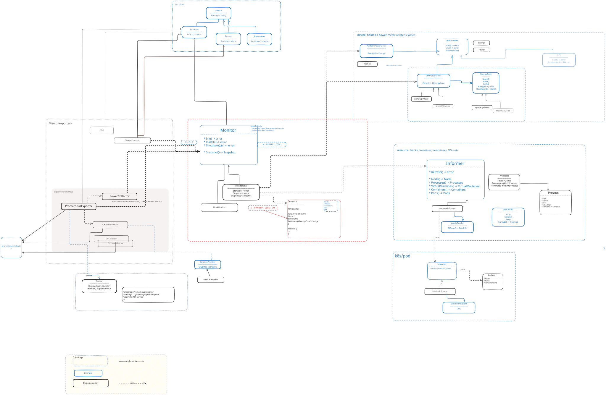

# Kepler Architecture

## Overview

Kepler (Kubernetes-based Efficient Power Level Exporter) reads hardware sensors on a node and exposes power and energy as Prometheus metrics. It uses node CPU utilization to split each CPU zone's power into active and idle, then attributes active power to workloads using their CPU time.

**Key Capabilities:**

- CPU energy or power readings from RAPL and hwmon
- Experimental NVIDIA GPU power monitoring via NVML with per-process attribution
- Independent CPU attribution for processes, containers, VMs, and pods
- Real-time power monitoring with configurable intervals
- Prometheus metrics export with multiple collectors
- Kubernetes-aware pod and container tracking
- Retention of previously observed workloads that exit between scrapes

## Architecture Documentation

This section provides comprehensive documentation of Kepler's architecture, design decisions, and implementation patterns.

### Core Architecture

| Document                                          | Description                                                       |
|---------------------------------------------------|-------------------------------------------------------------------|
| **[Design Principles](principles.md)**            | The fundamental principles that drive all architectural decisions |
| **[System Components](components.md)**            | Deep dive into each architectural layer and component             |
| **[Data Flow & Attribution](data-flow.md)**       | Power attribution algorithm and data flow patterns                |
| **[Concurrency & Thread Safety](concurrency.md)** | Thread safety guarantees and concurrent processing                |

### Implementation Details

| Document                                              | Description                                           |
|-------------------------------------------------------|-------------------------------------------------------|
| **[Interfaces & Contracts](interfaces.md)**           | Key interfaces, service contracts, and API boundaries |
| **[Configuration System](configuration.md)**          | Hierarchical configuration and option management      |
| **[GPU Power Monitoring](gpu-power-monitoring.md)**   | NVIDIA GPU power monitoring via NVML                  |
| **[MIG Power Attribution](mig-power-attribution.md)** | Per-process power attribution on MIG-enabled GPUs     |

## Quick Reference

### System Architecture Overview



**High-Level Data Flow:**

```text
Hardware (RAPL) ──→ Device Layer ──→ Monitor (Attribution) → Exporters
Hardware (NVML) ──↗                        ↑
/proc filesystem → Resource Layer ─────────┘
```

### Power Attribution Flow

- **CPU.** Read each zone's energy or power and split its power into active and idle. Processes, containers, VMs, and pods each receive a share of active power based on their CPU time.
- **GPU.** When enabled, the NVIDIA meter attributes GPU power to processes. The monitor aggregates those values by container and then by pod.

### Key Design Principles

- **Fair Power Allocation**: Retain terminated workloads within the configured energy threshold and capacity
- **Mathematical Integrity**: Use the same active power and interval for every workload's CPU share within a zone
- **M/V Pattern**: Separate computation from presentation
- **Data Freshness**: Configurable staleness with automatic refresh
- **Deterministic Processing**: Thread-safe with consistent results
- **Package Reuse**: Prefer well-maintained libraries over custom implementations
- **Configurable Exposure**: User control over metric collection and export
- **Implementation Abstraction**: Interface-based design for flexibility

## Getting Started

For developers new to the Kepler architecture:

1. **Start with [Design Principles](principles.md)** to understand the fundamental design drivers
2. **Review [System Components](components.md)** for the overall structure
3. **Study [Data Flow](data-flow.md)** to understand the power attribution algorithm
4. **Check [Concurrency](concurrency.md)** for thread safety patterns

For specific implementation work:

- **Adding new workload types**: See [System Components](components.md#4-resource-monitoring-internalresource)
- **Adding new exporters**: See [Interfaces](interfaces.md#powerdataprovider-contract)
- **Modifying power attribution**: See [Data Flow](data-flow.md#phase-3-workload-attribution)
- **Configuration changes**: See [Configuration System](configuration.md)
- **GPU power monitoring**: See [GPU Power Monitoring](gpu-power-monitoring.md)

## Related Documentation

- **[Power Attribution Guide](../../power-attribution-guide.md)**: Detailed explanation of power calculation methodology
- **[Development Setup](../../index.md)**: Setting up the development environment
- **[User Configuration Guide](../../../user/configuration.md)**: End-user configuration options

---

> **Note**: This architecture documentation reflects the current design as of the latest version. For historical context or evolution of design decisions, see the individual component documentation and git history.
