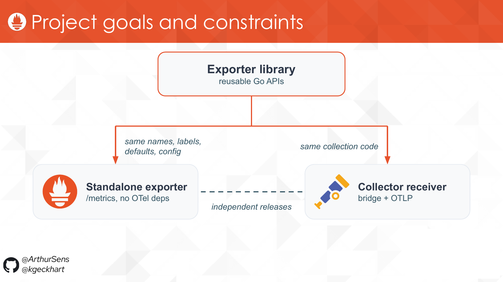
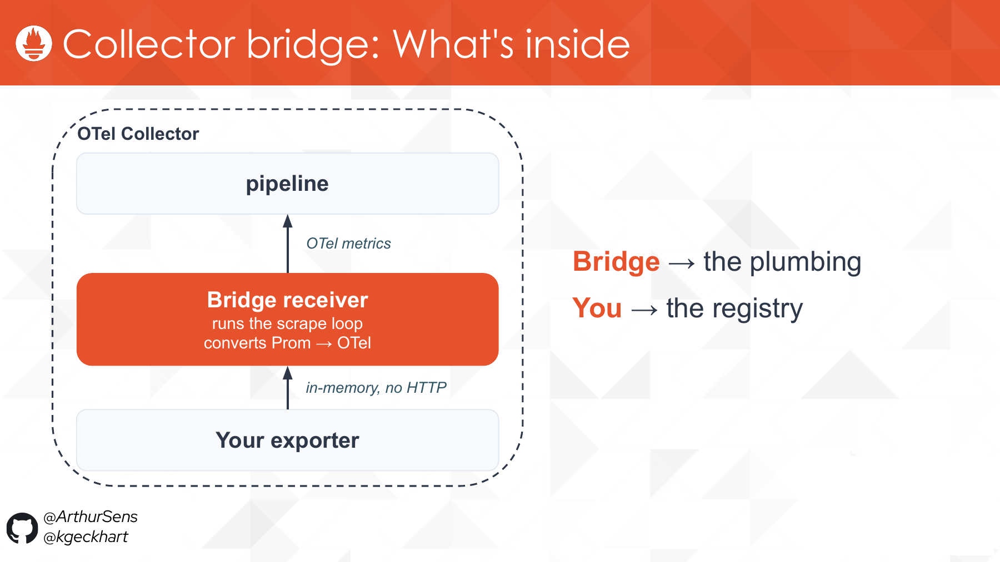

# EP-004: Embeddable Kepler runtime

**Status**: Draft
**Authors**: @ArthurSens
**Reviewers**: TBD
**Approvers**: TBD
**Created**: 2026-10-29
**Last Updated**: 2026-11-04

## Summary

Make Kepler's metrics collection and configuration reusable by downstream
projects so that users can run Kepler as part of an OpenTelemetry Collector.
Kepler would continue to own its collection capabilities, configuration, and
Prometheus metrics. A downstream adapter would use the existing [Prometheus
OpenTelemetry bridge](https://github.com/prometheus/opentelemetry-collector-bridge) to make those capabilities available through Collector
interfaces and pipelines.

This gives users a way to add energy observability to their existing Collector
deployment without operating a separate Kepler process or scraping its HTTP
endpoint. The standalone Kepler exporter remains supported, using the same
collection implementation.

## Problem Statement

OpenTelemetry Collector users who want Kepler's energy and power metrics
currently deploy Kepler separately, expose its Prometheus endpoint, and configure
the Collector's Prometheus receiver to scrape it. The Collector converts those
metrics and forwards them to the chosen backend.

That path already supports OTLP destinations without requiring a Prometheus
server. However, users still operate another workload, manage its configuration
and lifecycle, and maintain an HTTP scrape path between Kepler and the Collector.
For users who already manage a fleet of Collectors, energy collection remains a
separate operational concern.

Kepler users have asked for [documentation on collecting its metrics through
OpenTelemetry][otel-docs-request] and [whether an OpenTelemetry integration has
been implemented and released][otel-release-request].

OpenTelemetry adoption also makes this integration relevant beyond those
requests. The [CNCF 2025 Annual Cloud Native Survey][cncf-survey] reports that 49%
of respondents use OpenTelemetry in production and another 26% are evaluating
it.

The two ecosystems are also used together. [Grafana Labs' 2026 Observability
Survey][grafana-survey], based on 1,363 responses, reports that 65% of respondents'
organizations are investing in both Prometheus and OpenTelemetry. Investment
includes investigation and proofs of concept as well as production use.

The [2026 Prometheus and OpenTelemetry interoperability survey][interop-survey]
provides more specific evidence about infrastructure collection: 72% use
Prometheus exporters, 57% use OpenTelemetry receivers, and 49.4% combine
Prometheus-style and OpenTelemetry-style instrumentation. These results describe
a screened sample of 81 end users already using OpenTelemetry for metrics with a
Prometheus-compatible backend. They show how those users combine the ecosystems,
rather than measuring industry-wide adoption.

Making Kepler reusable within the Collector would support this combined use:
users could retain Kepler's Prometheus collection implementation while adding
energy metrics to their existing OpenTelemetry pipelines.

Kepler also lacks a supported reusable boundary for downstream integrations.
Its collectors are internal to the project, and its application assembles
collection together with standalone process concerns. Downstream projects cannot
simply reuse Kepler's full collection capabilities and configuration. Copying
those responsibilities or implementing collection again would create another
implementation to maintain and keep consistent.

## Goals

- **Make Kepler available within OpenTelemetry Collector deployments.** Users
  should be able to collect energy metrics through their existing telemetry
  agent and send them through its configured pipeline.
- **Expose all existing collection capabilities and their configuration.** This
  includes workload attribution, supported hardware backends, optional and
  experimental collection features, and the settings that control them. Existing
  hardware and feature limitations continue to apply.
- **Keep collection and configuration owned by Kepler.** Downstream integrations
  should reuse Kepler's behavior, defaults, and validation instead of maintaining
  their own collection logic or a reduced configuration model.
- **Reduce operational components and HTTP scrape work.** Allow collection in the
  hosting process without a separate Kepler workload, metrics endpoint, or HTTP
  exposition and parsing between Kepler and the Collector.
- **Preserve the standalone experience.** Existing users should retain their
  configuration, metrics, and deployment options.

## Non-Goals

- Replace Kepler's Prometheus metrics or rewrite collection using an
  OpenTelemetry SDK.
- Add an OTLP exporter or Collector-specific dependencies to Kepler itself.
- Change energy accounting, attribution algorithms, or supported hardware.
- Implement a fleet-management service or OpAMP support inside Kepler.
- Require existing standalone users to move to OpenTelemetry.

## Existing Work and Precedents

This proposal follows work already underway in the Prometheus ecosystem to make
exporters reusable within OpenTelemetry Collectors.

### Embeddable Exporter Pattern

The [embeddable exporter guidance][embedding-pattern] describes a separation
between configuration, metric collection, and the standalone application.
Exporters retain ownership of configuration and collection; consumers reuse
those capabilities without importing CLI or HTTP server behavior. Kepler would
follow this pattern while retaining its own collection implementation.

There are already concrete integrations using reusable exporter APIs:

- [Postgres exporter integration][postgres-adapter] constructs the exporter's
  runtime from its configuration and registers its collectors for the bridge.
- [Stackdriver exporter integration][stackdriver-adapter] similarly consumes the
  exporter's configuration and collection runtime.
- [YACE integration][yace-adapter] reuses the exporter's configuration, clients,
  and collection APIs in a Collector adapter.

These examples demonstrate the separation of responsibilities; Kepler does not
need to duplicate their exact API shapes.

### Prometheus OpenTelemetry Bridge

The [Prometheus OpenTelemetry bridge][bridge] adapts a Prometheus registry to the
OpenTelemetry Collector receiver interfaces. It provides the common integration
layer so that each exporter does not need to implement its own telemetry
conversion and Collector plumbing.

### OpenTelemetry Collector Prometheus Distribution

The [`otelcol-prometheus` distribution][distribution] is maintained in
`open-telemetry/opentelemetry-collector-releases`. Its [component manifest][manifest]
already includes adapters for Blackbox, Postgres, Stackdriver, and YACE, together
with OTLP exporters.

This provides an existing distribution model for embedded Prometheus exporters, and
Kepler would be distributed in the same way.

## Proposed Solution

Separate Kepler's reusable collection and configuration from the standalone
application. Downstream projects would consume those capabilities through an
adapter that uses the bridge to implement OpenTelemetry Collector interfaces.

```text
Current integration:
  Standalone Kepler -> HTTP metrics endpoint -> Collector Prometheus receiver
                    -> Collector pipeline -> backend

Proposed additional integration:
  Kepler collection inside Collector -> adapter + bridge
                                    -> Collector pipeline -> backend
```

The proposed path removes HTTP exposition, transport, and parsing between Kepler
and the Collector. Conversion from Prometheus metrics to OpenTelemetry still
occurs through the bridge.

### One Collection Library, Two Entrypoints

The following diagrams are reproduced from Arthur Sens and Kyle Eckhart's
[PromCon EU 2026 talk][promcon-talk], presented in Munich on October 8, 2026.



For Kepler, the exporter library would contain its collection capabilities and
configuration. The standalone CLI and the downstream Collector receiver would
both consume that library. The CLI would build the configuration from its flags
and configuration file and expose Prometheus metrics; the receiver would obtain
the collection settings from Collector configuration and pass them to Kepler.
Both paths would use the same collection implementation, defaults, and validation.



The downstream adapter would provide a registry containing Kepler's collectors.
The bridge would gather from that registry in memory, convert the metrics, and
pass them into the Collector pipeline. In this diagram, the bridge's "scrape
loop" means periodic gathering from the registry; it does not scrape an HTTP
endpoint.

The diagrams are from [slides 18 and 20 of the talk deck][promcon-slides].
For the full explanation, watch the recording:

[][promcon-video]

[Watch the full talk on YouTube][promcon-video].

### Benefits Through the Collector Ecosystem

Users can route Kepler metrics through the Collector's processors and exporters,
including OTLP export to compatible backends. This fits energy observability into
an existing vendor-neutral telemetry pipeline and allows backend changes through
pipeline configuration. [Collector documentation][collector] describes these
processing and export responsibilities.

Embedding also allows Kepler collection to participate in the management of the
hosting Collector. In deployments with suitable [OpAMP management support][opamp],
operators could manage its collection configuration alongside other Collector
components. This is an enabled ecosystem capability, dependent on the chosen
Collector and management setup; embedding does not provide remote management by
itself.

## Alternatives Considered

- **Continue scraping standalone Kepler.** This remains a valid, supported choice
  and already enables OTLP export through the Collector. It retains the separate
  workload and HTTP scrape path that this proposal aims to make optional.
- **Add native OTLP export to standalone Kepler.** This would address direct OTLP
  delivery but leave a separate process to operate and introduce another export
  path for Kepler to maintain. It would not make collection reusable inside a
  Collector.
- **Reimplement Kepler as an OpenTelemetry receiver.** This could provide a
  Collector component but would duplicate collection and attribution logic.
  Reusing Kepler through an adapter keeps ownership and fixes in one place.

[otel-docs-request]: https://github.com/sustainable-computing-io/kepler/issues/659#issuecomment-1979580960
[otel-release-request]: https://github.com/sustainable-computing-io/kepler/issues/659#issuecomment-2837786532
[cncf-survey]: https://www.cncf.io/wp-content/uploads/2026/01/CNCF_Annual_Survey_Report_final.pdf
[grafana-survey]: https://grafana.com/observability-survey/2026/
[interop-survey]: https://opentelemetry.io/blog/2026/otel-prometheus-interoperability/
[embedding-pattern]: https://github.com/prometheus/prometheus-opentelemetry-collector/blob/main/docs/embeddable-exporters.md
[postgres-adapter]: https://github.com/prometheus/prometheus-opentelemetry-collector/blob/main/receivers/postgres/lifecycle.go
[stackdriver-adapter]: https://github.com/prometheus/prometheus-opentelemetry-collector/blob/main/receivers/stackdriver/lifecycle.go
[yace-adapter]: https://github.com/prometheus/prometheus-opentelemetry-collector/blob/main/receivers/yace/lifecycle.go
[bridge]: https://github.com/prometheus/opentelemetry-collector-bridge
[distribution]: https://github.com/open-telemetry/opentelemetry-collector-releases/tree/main/distributions/otelcol-prometheus
[manifest]: https://github.com/open-telemetry/opentelemetry-collector-releases/blob/main/distributions/otelcol-prometheus/manifest.yaml
[collector]: https://opentelemetry.io/docs/collector/
[opamp]: https://opentelemetry.io/docs/collector/management/
[promcon-talk]: https://promcon.io/2026-munich/talks/unlocking-prometheus-exporters-in-the-opentelemetry-ecosystem/
[promcon-slides]: https://docs.google.com/presentation/d/15kXLkRqCc_JN6fEaTUGyOwECDUE6BED02aLirYfUKtw/edit
[promcon-video]: https://www.youtube.com/watch?v=xFBa88S0-jE
