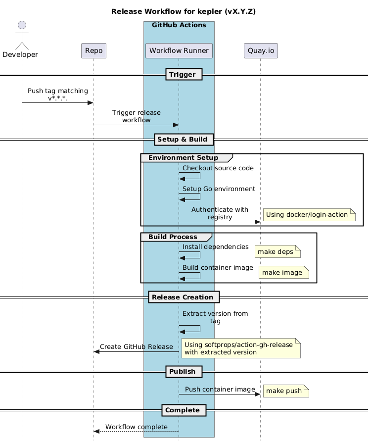

# Kepler Release Workflow

This document describes the release workflow for Kepler.

## Notes

- The release is automatically triggered by a tag push
- Container images are stored in Quay.io
- The workflow is fully automated through GitHub Actions
- After the GitHub release is created, the [Bump kepler-doc](../../.github/workflows/bump-kepler-doc.yaml) workflow opens a PR in [kepler-doc](https://github.com/sustainable-computing-io/kepler-doc) that moves its `kepler` submodule to the new tag. It is skipped for patches on an older minor, and can be re-run manually from the Actions tab.
- The docs bump uses a GitHub App installed on `kepler-doc` with read and write access to contents and pull requests. Its client ID goes in the `KEPLER_DOC_APP_CLIENT_ID` repository variable and its private key in the `KEPLER_DOC_APP_PRIVATE_KEY` secret.

## Release Process Overview

