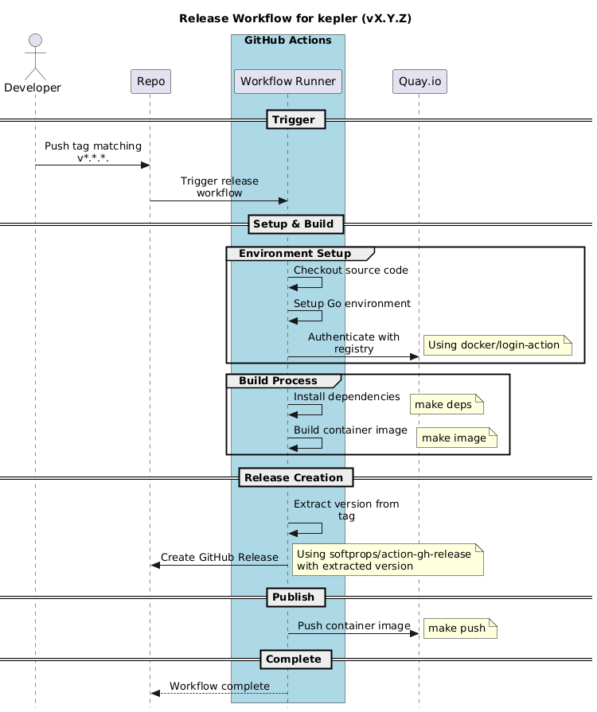

# Kepler Release Workflow

This document describes the release workflow for Kepler.

## Notes

- The release is automatically triggered by a tag push
- Container images are stored in Quay.io
- The workflow is fully automated through GitHub Actions

## Release Process Overview

## After Publishing a Release

Once the release workflow succeeds and both the Helm chart archive and container
image are published, open a follow-up PR to `main`:

1. Update the default `BASELINE_VERSION` in
   [`hack/test-helm.sh`](../../hack/test-helm.sh) to the new release version,
   without the leading `v`.
2. Update the script's `--help` default and the baseline version documented in
   [Helm Validation](e2e-testing.md#helm-validation).
3. Follow that guide to verify both upgrade modes.
